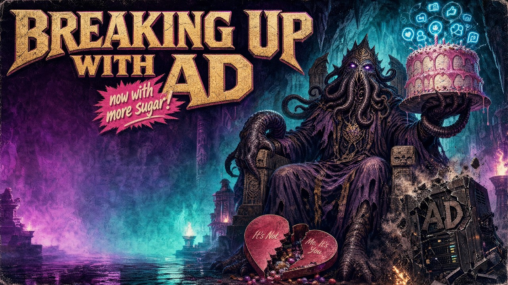

# ADios: Breaking up with Active Directory

Here are the slides and a link to the livestream recording of an informal presentation made to
my local cybersecurity guild, exploring the journey of replacing a hybrid Active Directory
environment with a new cloud-native foundation on Entra ID. This is an updated version of an
earlier BSides Tampa presentation. Neither was a polished keynote, but both were given in the
spirit of contributing back to a security community whose shared knowledge helps practitioners
(myself included) navigate the constraints and realities of their work.

  
*Cover art by [RansomWear](https://www.ransomwear.store) for [The Neon Temple](https://theneontemple.com).*

**▶️ [Watch the recording](https://www.youtube.com/live/FM-FWVZbE5w)** - streamed live from The Neon Temple, 2026-10-22.

**📄 [Download the slides (PDF)](ADios-Breaking-up-with-AD-2026-10-22-NeonTemple.pdf)** -
lightly maintained and may differ, *in small ways*, from the original stream (slides are
newer).

*Personal project. These slides and the views in them are my own, not those of any employer,
past or present. Some of the environments described are historical, now retired.*

---

## About the talk

Active Directory (AD) became the de facto standard for Windows-centric organizations to add
security, but today, removing AD or minimizing its footprint is considered a security
enhancement.

More than a technical optimization, switching from hybrid-AD to cloud-native Entra ID is a
risk reduction strategy. Have the capabilities of cloud native reached a tipping point where
more organizations can seriously consider reducing or eliminating AD? This session will
discuss a regulated organization's journey to cloud native, reasons to do so, challenges, and
lessons learned.

## Use & attribution

These slides are licensed under [CC BY-ND 4.0](LICENSE) and may only be shared whole and
unchanged, with credit along the lines of:

> "ADios: Breaking up with Active Directory" by Daniel Jarboe
> (https://github.com/jarboed/ADios), licensed under CC BY-ND 4.0.

Derivative works - remixes, edited versions, or new decks built on this material - are not
permitted by this license. Short quotations for commentary, review, or reporting remain
available under fair use.

Quotations, trademarks, logos, and third-party images in the deck remain the property of their
respective owners. The cover art is by RansomWear and is not covered by this license.

## Disclaimer

This presentation and repository are intended for educational purposes only and do not replace
independent professional judgment. All opinions and positions expressed in this presentation
are solely those of the presenter, and not necessarily those of any organization or employer.
The presenter assumes no liability or responsibility for any errors or omissions in any
content. This information is provided "as is," with no guarantees for completeness or accuracy,
and without warranties of any kind, express or implied.
